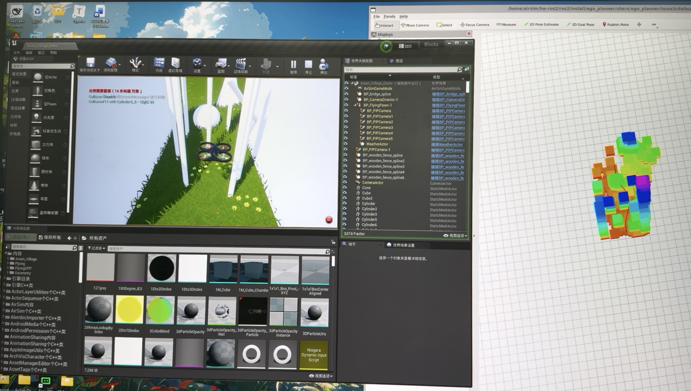

# ego-planner-airsim-px4-ros2

将 EGO-Planner ROS 2 接入 **UE4 / AirSim / PX4 SITL** 的避障工程核心文件归档。

UE4 提供仿真场景，AirSim 提供深度图像和里程计，EGO-Planner 构建局部障碍地图并规划轨迹，`position_cmd_to_px4.py` 将规划指令转换为 PX4 的 OFFBOARD 设定点。

基于 [ZJU FAST Lab 的 ego-planner-swarm ROS 2 分支](https://github.com/ZJU-FAST-Lab/ego-planner-swarm/tree/ros2_version)。

## 仿真与可视化



左侧为 UE4 / AirSim 仿真场景，右侧为 RViz 局部地图。图片用于展示运行环境和建图界面。

## 工程目录

```text
airsim/
├── hw-ros2/
│   ├── AirLib/
│   ├── MavLinkCom/
│   ├── external/rpclib/rpclib-2.3.0/
│   ├── cmake/
│   ├── ros2/src/
│   │   ├── ego-planner-swarm/     # 地图、搜索、优化、FSM 与轨迹管理
│   │   ├── hw_insight/           # PositionCommand → PX4 控制桥
│   │   ├── airsim_ros_pkgs/      # AirSim ROS 2 接入
│   │   ├── airsim_interfaces/
│   │   └── px4_msgs/
│   ├── config/airsim/settings.json
│   ├── baseline/                # 来源、参数摘要与文件校验清单
│   └── LICENSES/
├── px4v1.15.2/                  # 本地修改文件与许可证，非完整固件
└── Micro-XRCE-DDS-Agent-v2.4.2/
```

## 运行前准备

本机验证环境为 **Ubuntu 22.04 / WSL2、ROS 2 Humble、UE4 / AirSim、PX4 v1.15.2 和 Micro XRCE-DDS Agent 2.4.2**。

以下命令记录已构建好的原工程的启动方式，默认路径为：

| 工程 | 原环境路径 |
| --- | --- |
| ROS 2 工作区 | `~/hw-ros2/ros2` |
| PX4 工程 | `~/px4v1.15.2` |
| PX4 控制桥 | `~/hw-ros2/ros2/src/hw_insight/hw_insight/position_cmd_to_px4.py` |

如果工程放在其他位置，请替换命令中的路径。仓库本身采用 `airsim/` 归档层级，直接克隆后的路径与上表不同。

开始前确认：

- 已准备兼容的 UE4 / AirSim 插件和地图，完成原工程构建。
- AirSim 车辆名为 `PX4`，深度相机名为 `CameraDepth`。
- [settings.json](airsim/hw-ros2/config/airsim/settings.json) 已放到 Windows 的 `%USERPROFILE%\Documents\AirSim\settings.json`，网络地址与实际环境一致。
- PX4 与 `px4_msgs` 版本匹配，系统时间稳定，只运行一套规划器、轨迹服务器和控制桥。

**每个运行 ROS 节点或 ROS 命令的终端都先加载环境：**

```bash
# 如果启用了 Conda，先退出当前环境。
conda deactivate 2>/dev/null || true
source /opt/ros/humble/setup.bash
source ~/hw-ros2/ros2/install/setup.bash
```

## 启动步骤

### 1. 启动 UE4 场景和 DDS Agent

在 UE4 中启动配置好的 AirSim 场景。在独立终端运行 DDS Agent：

```bash
MicroXRCEAgent udp4 -p 8888
```

端口需与 PX4 的 DDS 通信配置一致。

### 2. 启动 PX4 SITL

在另一个终端运行：

```bash
cd ~/px4v1.15.2
make px4_sitl_default none_iris
```

### 3. 启动 AirSim ROS 节点

加载 ROS 环境后运行：

```bash
ros2 launch airsim_ros_pkgs airsim_node.launch.py host:=172.27.208.1
```

`172.27.208.1` 是本机基线使用的 Windows 主机地址，换机器后应替换，并与 AirSim / PX4 网络设置对应。

### 4. 启动 RViz

在新终端加载 ROS 环境后运行：

```bash
ros2 launch ego_planner rviz.launch.py
```

### 5. 启动单机规划器

在新终端加载 ROS 环境后运行，并保存本次控制台日志：

```bash
ros2 launch ego_planner single_run_in_sim.launch.py 2>&1 | tee ~/ego_arrival_diag.log
```

运行日志保存在仓库外。

### 6. 启动 PX4 控制桥

在新终端加载 ROS 环境后运行：

```bash
/usr/bin/python3 ~/hw-ros2/ros2/src/hw_insight/hw_insight/position_cmd_to_px4.py \
  --ros-args \
  -p mode:=ego \
  -p fixed_height:=2.0 \
  -p px4_timestamp_mode:=receiver
```

等待桥输出“起飞完成，稳定悬停”，再发送任务触发。`fixed_height` 用于起飞悬停，之后按 EGO 的三维轨迹执行。

### 7. 触发规划任务

在已加载 ROS 环境的终端执行一次：

```bash
ros2 topic pub --once /traj_start_trigger \
  geometry_msgs/msg/PoseStamped \
  '{header: {frame_id: world}, pose: {orientation: {w: 1.0}}}'
```

## 成功基线参数

| 参数 | 归档值 |
| --- | --- |
| 目标位置（ENU） | `(0.15, 15.0, 2.0)` m |
| 起飞高度 | `2.0 m` |
| 规划速度 / 加速度上限 | `0.5 m/s` / `1.0 m/s²` |
| 地图分辨率 / 障碍膨胀 | `0.1 m` / `0.5 m` |
| 深度相机分辨率 / FOV | `200 × 150` / `90°` |
| 桥的 PX4 时间戳模式 | `receiver` |

2026-11-11 本机配套场景测试中，观察到无障碍碰撞并到达目标，日志最终进入 `WAIT_TARGET`。该记录属于已验证的原环境。

## 归档范围与使用边界

归档包含规划器、控制桥、配套消息、AirSim ROS 接入、SDK / DDS Agent 运行源码，以及 PX4 的本地修改文件。源码、CMake、launch、配置及原包元数据按原文件保存。

日志、缓存、`build/install`、录包、备份、测试程序和教学示例不收录。名称含 `Test` 的标准 PX4 `.msg` 属于协议定义，仍保留以维持消息包一致性。

这是一份原样核心文件归档。独立部署需要完整上游依赖和 UE4 引擎、插件、地图资产；原构建规则可能引用未收录的测试或可选模块目录。PX4 目录只保存本地修改文件，不是完整固件源码。

源码来源与校验清单见 [source_manifest.json](airsim/hw-ros2/baseline/source_manifest.json)，各组件许可证见 [LICENSES](airsim/hw-ros2/LICENSES/README.md)。
